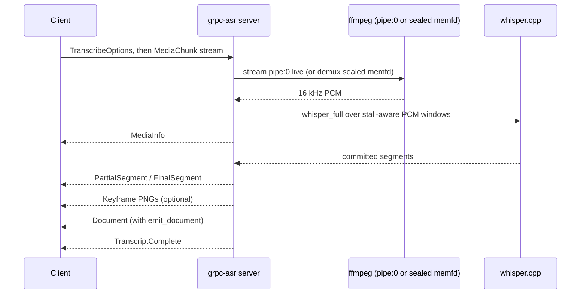

# grpc-asr

gRPC ASR collector (whisper.cpp) for audio and video, projecting transcripts
into the gRParse Document data plane.

A standalone C++ gRPC server embedding whisper.cpp. Media streams in over a
bidirectional `Transcribe` RPC; timed transcript segments stream back as the
decoder commits them, so transcription starts while the upload is still in
flight for both in-process audio (WAV, MP3, FLAC) and streamable containers
demuxed over an ffmpeg pipe (Ogg, Matroska/WebM, fast-start MP4/MOV, AMR,
MPEG-PS/TS, raw ADTS AAC). Seekable-only containers (trailing-`moov` MP4, AVI,
ASF/WMA/WMV) and keyframe extraction use a single-copy anonymous memfd
(diskless), with optional keyframe stills emitted alongside the transcript.



## Unified media streaming

This repository is the canonical maintained service, incorporating the former
`whisper-grpc` prototype. Both duplicate projects are now archived. One `grpc-asr-server` registers the existing `AsrService` and the
additive `MediaService` and `SpeechWorkerService` contracts on port 50055.
Existing ASR protobuf messages remain unchanged.

The media API supports incremental direct and allowlisted HTTP input, original
source bytes with checksums, native encoded packets and audio, stream UUIDs,
explicit open/finish accounting, filtered subscriptions and bounded hydration.
An empty subscription UUID list follows all streams on this server, including
future streams. There is no durable replay store. Native FFmpeg calls process
streamable containers without request files or subprocesses. The existing
collector API retains its Document projection, keyframes and seekable-video
compatibility path.

Whisper processing borrows the existing CPU/CUDA/OpenVINO model pool. The two
APIs share loaded weights and concurrency limits. The media-to-worker call uses
an in-process gRPC channel by default; `GRPC_ASR_WORKER_TARGET=host:port`
selects a separately deployed worker using the same typed contract. `GRPC_ASR_STREAM_MODEL`
selects a loaded model for the window worker (defaults to the first loaded model).
`GRPC_ASR_STREAM_BACKEND=parakeet` instead selects the native CPU Parakeet
adapter, with weights at `GRPC_ASR_PARAKEET_MODEL_PATH`; the existing collector
API continues to serve its configured Whisper models. Parakeet supports
transcription, not translation or language hints.

Speech requests select fixed windows or speech-aware boundaries. Mount Silero
weights and set `GRPC_ASR_VAD_MODEL_PATH` for speech-aware chunking. Maximum
window limits still apply when there is no pause; the caller selects failure
or a forced cut with overlap. Raw hypotheses remain available alongside
reconciled revisions, including unresolved joins.

HTTP ingestion is disabled unless `GRPC_ASR_HTTP_ORIGINS` contains exact comma-
separated `scheme://host:port` origins. Private addresses additionally require
`GRPC_ASR_HTTP_ALLOW_PRIVATE=1`. Redirects and nested media URLs are refused.
`GRPC_ASR_MACHINE_ID` optionally supplies a stable UUID for producer metadata.

For a single CPU deployment, put weights in `models/` and run
`docker compose up --build`. All three interfaces use port 50055, bound to
loopback by default. For smart chunking set
`GRPC_ASR_VAD_MODEL_PATH=/models/ggml-silero-v5.1.2.bin` before starting Compose.
Models are mounted read-only and never fetched by requests. Keep
`GRPC_ASR_MODELS` explicit when the directory also contains VAD or Parakeet
weights; automatic Whisper discovery expects only Whisper weights.

For local qualification, provision the weights and run
`bash scripts/qualify-unified.sh build models /path/to/silero.bin whisper`.
The same command with `parakeet` additionally requires
`GRPC_ASR_PARAKEET_MODEL_PATH`. It tests the actual unified server, including
HTTP, fixed/smart video windows, subscription delivery and hydration. Native
ARM and GPU results must be reported separately from CPU results.

## Wire API

`ai.pipestream.asr.v1.AsrService` (see
[`proto/ai/pipestream/asr/v1/asr_service.proto`](proto/ai/pipestream/asr/v1/asr_service.proto)).

`Transcribe(stream TranscribeRequest) returns (stream TranscribeResponse)`:
the first request message carries `TranscribeOptions` (`model`, `language`,
`task`, `word_timestamps`, `emit_keyframes`, `keyframe_interval_seconds`,
`emit_document`, `diarize`, `filename`, `window_seconds`, `decoding`,
`channel_mode`, `remote`), the rest carry the encoded media as
`MediaChunk` messages. Response events arrive in order: `MediaInfo`
(including `ContainerFamily`), then `PartialSegment` and `FinalSegment`
events (finals replace partials by index), optional `Keyframe` PNGs, and a
`TranscriptComplete` trailer with counts, effective `window_seconds`,
per-channel segment counts, distinct detected `languages`, and
`decode_warnings`: media cut short or corrupt in the middle is transcribed
as far as it reads and the trailer says, in typed fields, that the decoder
skipped errors (`DECODER_ERRORS`, with a count) or that less audio came
out than the media states (`SHORTER_THAN_DECLARED`, with both lengths).

- **Local decoding options (`TranscribeOptions.decoding`):** `initial_prompt`
  (<= 1024 UTF-8 bytes), `SamplingStrategy` (`GREEDY` or `BEAM_SEARCH`),
  `beam_size` (1..8), `best_of` (1..8), `no_speech_threshold` (default 0.6),
  `logprob_threshold` (default -1.0), `entropy_threshold` (default 2.4), and
  `suppress_non_speech_tokens`. Out-of-range values fail `INVALID_ARGUMENT`
  before any media byte is read. Every Whisper segment carries
  `no_speech_prob` and `suppressed` (set when `no_speech_prob` exceeds the
  no-speech threshold and `avg_logprob` falls below the logprob threshold).
- **Multi-channel separation (`TranscribeOptions.channel_mode`):**
  `CHANNEL_MODE_MIXDOWN` (default) mixes all channels to mono;
  `CHANNEL_MODE_PER_CHANNEL` decodes each source channel independently (up to
  `GRPC_ASR_MAX_CHANNELS`, default 2; above the cap fails `INVALID_ARGUMENT`
  before decoding). Segments carry zero-based `channel` and speaker labels
  `C1`, `C2`, ... (or `C1-S1`, `C2-S1`, ... when `diarize` is also set), and
  `TranscriptComplete.segment_count_by_channel` reports per-channel counts.
- **Speaker diarization (`diarize`):** asks the decoder for speaker turns;
  mono/mixdown segments carry stream-local `speaker_id` (`S1`, `S2`, ...). A
  model without speaker-turn training never predicts a turn, so everything
  stays on the first speaker.
- **Per-segment language:** `Segment.language` carries the ISO 639-1 code
  detected (or pinned) for that window, and `TranscriptComplete.languages`
  lists distinct codes in first-appearance order (`TranscriptComplete.language`
  remains the first).
- **Stall-aware windowing:** `TranscribeOptions.window_seconds` is clamped into
  `[GRPC_ASR_MIN_WINDOW_SECONDS, GRPC_ASR_WINDOW_SECONDS]`. Once at least
  `min_window_seconds` of PCM is buffered, if the upload stalls for
  `GRPC_ASR_WINDOW_STALL_MS` before EOF, the window cuts early and decodes
  immediately rather than waiting for the full maximum window.
- **Remote transcription (`TranscribeOptions.remote`):** forwards the media as
  streaming `multipart/form-data` over `libcurl` to an OpenAI-compatible
  `verbose_json` endpoint when authorized by `GRPC_ASR_REMOTE_ALLOWED_HOSTS`
  (`FAILED_PRECONDITION` when unset; `PERMISSION_DENIED` when unlisted or
  resolving to loopback/private/link-local addresses without an explicit
  `localhost` or IP literal allowlist entry). Caller HTTP headers are never
  logged or echoed in status messages.

With `emit_document`, one `ai.pipestream.document.v1.Document` event is
emitted immediately before the trailer: the collector-side fold of the
transcript.

- Final non-suppressed segments become text items located by **time
  provenance**: `prov[0].time` is the segment's span in milliseconds, and with
  `word_timestamps` one further entry per word carries that word's span plus
  its charspan (Unicode code points) inside the item text. Segments with
  `suppressed = true` stay on the typed stream and are skipped by the fold.
  Speakers are registered in `Document.media.speakers` only for speakers/channels
  that produced spoken text.
- `Document.body.children` is ordered by media time (`prov[0].time.start_ms`,
  pictures before texts at identical timestamps) so interleaved video keyframes
  and transcript segments read chronologically while the `texts` and `pictures`
  arenas keep arrival order.
- Every item keeps `TrackSource` (seconds) and
  `CollectorSource{collector: "asr", model, version, confidence}` for
  consumers that already read them. The confidence is a rescaled decoder
  score, not a calibrated probability, so the raw mean token logprob rides
  the same `CollectorSource` as a typed `raw_score` with `raw_score_kind`
  `"avg_logprob"`. A segment that scored no token claims neither field, and
  nothing is written in their place; a score of exactly 0 is a real value.
- Each text item sets `TextItemBase.meta.language` from `Segment.language`.
  Document-level `body.meta.language` and `Document.source_meta.language` are
  populated when at most one language is present and left unset on
  multi-language transcripts. The decoded duration and codec land in
  `Document.media`; the filename, sniffed mimetype, and incremental FNV-1a
  content hash in `Document.name` and `Document.origin`.
- Keyframes become picture items whose `ImageRef.uri` is
  `keyframe:<timestamp_ms>`, a pointer back at the typed event rather than
  embedded PNG bytes, so the Document stays one bounded message; the frame's
  true instant is its own zero-length time span.

The typed event stream remains the lossless wire: per-word probabilities,
segment indexes, suppressed hallucinations, and the trailer's counts stay
there. The document schema is vendored verbatim from gRParse
(`proto/ai/pipestream/document/v1/document.proto`); do not edit it here.

`GetServiceInfo` reports the build, backend, loaded models, caps,
`min_window_seconds`, `max_window_seconds`, `warmed_up`, and `remote_enabled`,
plus the `UiInfo` block the shared demo shell reads to build its tab bar.
Standard `grpc.health.v1.Health` and server reflection are registered.

### Supported containers and memory model

| Container family | Extensions | Ingest & decode path |
|---|---|---|
| WAV, MP3, FLAC | `.wav`, `.mp3`, `.flac` | In-process (`miniaudio`) live while uploading |
| Ogg (Opus, Vorbis, FLAC, Speex) | `.ogg`, `.oga`, `.opus` | Live `ffmpeg -i pipe:0` while uploading |
| Matroska / WebM | `.mkv`, `.webm` | Live `ffmpeg -i pipe:0` while uploading |
| ISO BMFF (fast-start `moov` before `mdat`) | `.mp4`, `.m4a`, `.m4v`, `.mov` | Live `ffmpeg -i pipe:0` while uploading |
| ISO BMFF (trailing `moov` after `mdat`) | `.mp4`, `.m4a`, `.m4v`, `.mov` | Single-copy sealed memfd once upload finishes |
| AVI, ASF / WMA / WMV | `.avi`, `.asf`, `.wma`, `.wmv` | Single-copy sealed memfd once upload finishes |
| AMR-NB / AMR-WB | `.amr` | Live `ffmpeg -i pipe:0` while uploading |
| MPEG-PS, MPEG-TS | `.mpg`, `.mpeg`, `.ts`, `.m2ts` | Live `ffmpeg -i pipe:0` while uploading |
| Raw ADTS AAC | `.aac` | Live `ffmpeg -i pipe:0` while uploading |

When magic-byte sniffing does not match (for example custom header wrappers),
a `TranscribeOptions.filename` ending in one of the routed media extensions
above falls back to the ffmpeg path instead of failing `UNIMPLEMENTED`.
Trade-off: audio-only transcription on a pipeable container allocates zero
memfds beyond the upload chunks; enabling `emit_keyframes` or
`CHANNEL_MODE_PER_CHANNEL` on an ffmpeg container switches the upload buffer
itself into a single anonymous memfd so `ffprobe` and concurrent `ffmpeg`
readers share strictly one in-memory copy (`1x` media size, never `2x`).
Errors: cap overruns are `RESOURCE_EXHAUSTED`, undecodable media is
`INVALID_ARGUMENT`, unknown containers are `UNIMPLEMENTED`, remote allowlist
blocks are `FAILED_PRECONDITION` / `PERMISSION_DENIED`, decoder faults are
`INTERNAL`.

A stream stops working the moment its client cancels or its deadline
passes, whether it is decoding speech or a silent stretch that commits no
segment, waiting for a free model state, probing a video, or extracting
keyframes: the decoder and every ffmpeg child watch the call. A stream
that waits for a model state longer than `GRPC_ASR_QUEUE_TIMEOUT_SECONDS`
fails `RESOURCE_EXHAUSTED`.

## Build and test

```bash
cmake -S . -B build -G Ninja -DCMAKE_BUILD_TYPE=Release -DBUILD_TESTING=ON
cmake --build build --target grpc-asr-server grpc-asr-tests
ctest --test-dir build -L asr --output-on-failure
```

gRPC and whisper.cpp are FetchContent-pinned; no system gRPC needed. Two
tests need provisioning and skip (exit 77) without it: `transcriber-test`
and `asr-service-test` need `models/ggml-tiny.en.bin` (`curl -L -o
models/ggml-tiny.en.bin
https://huggingface.co/ggerganov/whisper.cpp/resolve/main/ggml-tiny.en.bin`),
and the video cases need `ffmpeg` and `ffprobe` on PATH. The tests author
their fixtures with `GRPC_ASR_TEST_FIXTURE_FFMPEG` (default `ffmpeg`), which
needs the libx264, libopus and libvorbis encoders; the image builds point it
at a distribution ffmpeg and test the decode-only one they ship.
Set `GRPC_ASR_TEST_REQUIRE_MODELS=1` to turn a missing model or sample into
a test failure instead of a skip; CI does, after fetching the model at a
pinned revision and checking its sha256.

Backend variants: `-DGRPC_ASR_CUDA=ON` (GGML CUDA) and
`-DGRPC_ASR_OPENVINO=ON` (ggml's OpenVINO backend for the whole Whisper
graph, plus the whisper OpenVINO encoder; needs OpenVINO 2026 or newer, its
TBB, and the OpenCL headers and ICD loader at build time, and ships as
`Dockerfile.openvino`).

## Run

```bash
GRPC_ASR_BACKEND=cpu GRPC_ASR_MODELS_DIR=./models ./build/grpc-asr-server
```

The process loads every configured model at startup and fails loud: a
missing backend or weight file stops the boot, never the first RPC. Weights
are files named `ggml-<model>.bin` in the models dir; `GRPC_ASR_MODELS`
picks a subset, unset discovers all.

| Env | Default | Meaning |
|---|---|---|
| `GRPC_ASR_LISTEN_ADDRESS` | `0.0.0.0:50055` | listen address |
| `GRPC_ASR_BACKEND` | `cuda` | `cuda` \| `openvino` \| `cpu`; never silently substituted |
| `GRPC_ASR_CUDA_DEVICE` | `0` | CUDA device index |
| `GRPC_ASR_OPENVINO_MODE` | `full` | how the `openvino` backend runs Whisper: `full` puts the whole graph (conv, encoder, cross-attention and decoder) on the device and fails startup unless a warmup pass shows every compute node there; `encoder` runs only the encoder on the device from a converted IR and decodes on CPU. Never switched for you; see [Whisper on an Intel GPU](#whisper-on-an-intel-gpu) |
| `GRPC_ASR_OPENVINO_DEVICE` | `GPU` | OpenVINO device for the `openvino` backend, e.g. `GPU.1` on a multi-GPU host (OpenVINO names a lone GPU `GPU` and several `GPU.0`, `GPU.1`, ...); the OpenVINO image ships only the GPU plugin, a device OpenVINO cannot open stops the boot, and device lists (`AUTO:`, `HETERO:`, `MULTI:`, `BATCH:`) are refused because OpenVINO could move work to CPU through them |
| `GRPC_ASR_OPENVINO_CACHE_DIR` | `/tmp/grpc-asr-openvino-cache` | OpenVINO compiled-kernel cache directory; mount a persistent volume here to skip first-boot shader compilation across container restarts. In `full` mode the cached graphs include their weights: size the volume at twice the model files |
| `GRPC_ASR_MODELS_DIR` | `/models` | read-only weight mount |
| `GRPC_ASR_MODELS` | discover | comma list of model names to load |
| `GRPC_ASR_CONCURRENCY` | `2` | whisper states per model (concurrent transcriptions) |
| `GRPC_ASR_WARMUP` | `1` | run a 1 s digital-silence inference pass on every pooled whisper state before listening (`0` disables); warmup failures exit non-zero at startup. `0` is refused with `GRPC_ASR_OPENVINO_MODE=full`, whose placement check runs on this pass |
| `GRPC_ASR_QUEUE_TIMEOUT_SECONDS` | `1800` | how long a stream waits for a free whisper state before `RESOURCE_EXHAUSTED`; `0` waits as long as the client does |
| `GRPC_ASR_MAX_MEDIA_BYTES` | `268435456` | upload cap, overrun is `RESOURCE_EXHAUSTED` |
| `GRPC_ASR_MAX_DURATION_SECONDS` | `14400` | media duration cap, overrun is `RESOURCE_EXHAUSTED` |
| `GRPC_ASR_WINDOW_SECONDS` | `480` | maximum PCM window per `whisper_full`; bounds resident PCM |
| `GRPC_ASR_MIN_WINDOW_SECONDS` | `30` | minimum buffered PCM seconds before an upload stall triggers an early window cut; also lower clamp bound for `TranscribeOptions.window_seconds` |
| `GRPC_ASR_WINDOW_STALL_MS` | `500` | upload stall threshold (ms) after `GRPC_ASR_MIN_WINDOW_SECONDS` is buffered; `0` disables stall cuts |
| `GRPC_ASR_MAX_CHANNELS` | `2` | maximum source channels allowed under `CHANNEL_MODE_PER_CHANNEL` |
| `GRPC_ASR_THREADS` | `min(4,hw)` | whisper decode threads |
| `GRPC_ASR_KEYFRAME_INTERVAL_SECONDS` | `10` | default keyframe spacing |
| `GRPC_ASR_DOCUMENT_WORD_PROVENANCE` | `1` | per-word provenance in the folded Document; `0` keeps segment spans only. Costs one provenance entry per word (~150 per transcribed minute, ~72k over eight hours) in a single bounded message |
| `GRPC_ASR_REMOTE_ALLOWED_HOSTS` | *(empty, off)* | comma-separated host allowlist for `TranscribeOptions.remote` (`host`, `host:port`, `*.domain`, or `*`); loopback/private/link-local targets additionally require an explicit `localhost` or IP literal entry |
| `GRPC_ASR_METRICS_ADDRESS` | *(empty, off)* | `host:port` for the HTTP/1.1 Prometheus `/metrics` exporter |
| `GRPC_ASR_METRICS_INTERVAL_SECONDS` | `60` | stdout metrics line; `0` off |
| `GRPC_ASR_TOOL_INACTIVITY_SECONDS` | `120` | ffmpeg/ffprobe no-output kill timer |
| `GRPC_ASR_FFMPEG` / `GRPC_ASR_FFPROBE` | `ffmpeg`/`ffprobe` | tool paths |

### Observability (`GRPC_ASR_METRICS_ADDRESS`)

Setting `GRPC_ASR_METRICS_ADDRESS=0.0.0.0:9095` (or `127.0.0.1:9095`) starts an
HTTP/1.1 listener serving Prometheus text exposition at `GET /metrics`:

- **Pool & queue:** `grpc_asr_states_total{model}`, `grpc_asr_states_busy{model}`,
  `grpc_asr_queue_depth{model}`, `grpc_asr_queue_depth_max{model}`,
  `grpc_asr_queue_wait_seconds{model}` (histogram), `grpc_asr_warmup_seconds`.
- **Placement:** `grpc_asr_whisper_off_device_nodes_total`, the Whisper
  compute nodes that ran outside the selected OpenVINO device after startup
  (`GRPC_ASR_OPENVINO_MODE=full`). Startup fails on any; this counts what a
  later request shape might still move. Alert on anything above 0.
- **Active streams & resident media bytes:** `grpc_asr_streams_active`,
  `grpc_asr_upload_bytes_resident`, `grpc_asr_memfd_bytes_resident`.
- **Latency, throughput & windowing:** `grpc_asr_first_segment_seconds{model,path}`
  (`path="live"` or `"ffmpeg"`), `grpc_asr_realtime_factor{model,backend}`
  (audio seconds per wall decode second), `grpc_asr_windows_total`,
  `grpc_asr_window_redecodes_total`, `grpc_asr_window_seconds_last`.
- **Outcomes & child tools:** `grpc_asr_stream_end_total{result}` (`ok`,
  `cancelled`, `deadline`, `queue_timeout`, `byte_cap`, `duration_cap`,
  `invalid_media`, `unknown_container`, `tool_error`, `internal`),
  `grpc_asr_tool_runs_total{tool,outcome}` (`tool="ffmpeg"|"ffprobe"`,
  `outcome="ok"|"rejected"|"exec_failed"|"inactivity_killed"|"cancelled"`),
  `grpc_asr_decode_warnings_total{code}` (`decoder_errors`,
  `shorter_than_declared`: transcripts that ended OK with that warning),
  `grpc_asr_streaming_unexpected_failures_total{handler}` (`pull`,
  `ingest_processing`, `ingest_finalization`, `subscribe`, `speech_worker`: a
  streaming handler answered `INTERNAL` with its fixed message because of an
  exception it did not expect; the cause is one stderr line starting
  `grpc-asr streaming:` with the handler and the stream id. Alert on any
  increase),
  `grpc_asr_audio_seconds_total{model}`, `grpc_asr_keyframes_total`,
  `process_resident_memory_bytes`, `process_cpu_seconds_total`.

## Docker

Three image variants, one per backend; tests run inside every image build
and gate it:

```bash
docker build -t grpc-asr .                                # CUDA (default)
docker build -f Dockerfile.cpu -t grpc-asr:cpu .          # CPU only
docker build -f Dockerfile.openvino -t grpc-asr:openvino . # Intel OpenVINO
docker run --rm --read-only --tmpfs /tmp --gpus all \
  -v ./models:/models:ro -p 50055:50055 grpc-asr
```

The hot path is diskless: media lives in memory and memfds, so run the
container `--read-only`.

The OpenVINO image carries OpenVINO 2026.4.1 (Intel's release archive,
sha256-pinned, on an ubuntu:26.04 base), the Intel GPU plugin, and the NEO
compute runtime (`intel-opencl-icd` 26.05 from Ubuntu's 26.04 archive,
Battlemage-capable); it defaults to `GRPC_ASR_BACKEND=openvino`. Whisper runs
on an Intel GPU (`GRPC_ASR_OPENVINO_DEVICE`, default `GPU`), so the container
needs the render device:

```bash
docker run --rm --read-only --tmpfs /tmp --device /dev/dri \
  --group-add $(getent group render | cut -d: -f3) \
  -v ./models:/models:ro -p 50055:50055 grpc-asr:openvino
```

`--group-add render` because the image runs as the unprivileged user, which
has no render-node access otherwise. The OpenVINO compile cache defaults to
`GRPC_ASR_OPENVINO_CACHE_DIR=/tmp/grpc-asr-openvino-cache` because the models
mount is read-only; mount a dedicated persistent volume at that directory (or on
CUDA, mount `CUDA_CACHE_PATH` with `CUDA_CACHE_DISABLE=0`) to persist compiled
device kernels across restarts, while startup warmup (`GRPC_ASR_WARMUP=1`)
pre-populates per-state scratch buffers and kernels before the gRPC port opens.
Without `/dev/dri` the server refuses to boot: it asks OpenVINO for the
device first and stops with the list of what OpenVINO does see, never on
the first RPC and never on another device.

### Whisper on an Intel GPU

`GRPC_ASR_OPENVINO_MODE` picks one of two placements. The startup log states
the one in force, with the card's own name, and one line per model:

```
grpc-asr openvino: mode full (GRPC_ASR_OPENVINO_MODE), device GPU (Intel(R) Arc(TM) ... Graphics (dGPU))
grpc-asr placement: large-v3 full graph on OpenVINO GPU (Intel(R) Arc(TM) ... Graphics (dGPU)); compute nodes on the device: conv 6/6, encoder .../..., cross .../..., decoder .../...
```

| Mode | On the device | On CPU | Needs in the models mount |
|---|---|---|---|
| `full` (default) | conv, encoder, cross-attention, decoder | mel spectrogram, token sampling, Silero VAD | `ggml-<name>.bin` only |
| `encoder` | encoder | everything else, the decoder included | `ggml-<name>.bin` plus `ggml-<name>-encoder-openvino.xml` / `.bin` from whisper.cpp's `convert-whisper-to-openvino` tooling |

`full` runs the plain ggml weights through ggml's OpenVINO backend, which
translates each Whisper graph to an OpenVINO model and compiles it for the
device. It is strict about where the work lands:

- The device must exist. The server asks OpenVINO what it can open before
  it loads anything; a missing render node is a startup failure that lists
  the devices OpenVINO sees.
- Every state must hold the device. whisper.cpp carries on with CPU when a
  GPU backend fails to start; that is a startup failure here.
- Every compute node must run on it. ggml's scheduler hands an op the
  device cannot run to the CPU backend without a word. The warmup pass
  records the scheduler's real choice for each node of all four graphs, and
  any node elsewhere stops startup with the graph, the op and the backend
  that took it (`decoder: 4 x MUL_MAT on CPU`). After startup the same
  check keeps counting into `grpc_asr_whisper_off_device_nodes_total`.

Model format for `full`: the weights must be a type the backend runs. The
unquantized `f16` files (`ggml-large-v3.bin`, `ggml-base.en.bin`, ...) and
`q8_0`, `q5_0`, `q5_1`, `q4_0`, `q4_1`, `q4_k`, `q5_k` and `q6_k`
quantizations are accepted. `q5_0` is the quantization most published
whisper.cpp files use (`ggml-large-v3-turbo-q5_0.bin`); upstream ggml's
OpenVINO backend has no path for it, and this build adds one
(`cmake/PatchGgmlOpenvino.cmake`, written up for upstream in
`docs/upstream/ggml-openvino-q5_0.md`): the 5-bit values run on the device
as 8-bit weights with one scale per 32, the layout `q8_0` already uses.
Any other type (`q2_k`, `q3_k`) is refused by name at startup; requantize
from the f16 file with whisper.cpp's `quantize` tool
(`quantize ggml-x.bin ggml-x-q5_0.bin q5_0`) or serve the f16 file. `f16`,
`q8_0`, `q5_0`, `q5_1` and `q4_0` are the ones this repository has run end
to end.

`full` uses whisper.cpp's flash-attention graphs, the only form the backend
translates completely. The Whisper models of the pool are what moves to the
device; the Parakeet streaming backend and Silero VAD are separate models
that whisper.cpp runs on CPU in every image. Graphs compile on first use, so the first boot of a
model is slow; `GRPC_ASR_OPENVINO_CACHE_DIR` on a volume keeps the compiled
graphs. In `full` mode a cached graph is stored with its weights (OpenVINO's
`OPTIMIZE_SPEED` cache), so the directory grows to about the size of the
model files, more once beam search or a temperature fallback has compiled a
second decoder graph: give it a volume with twice the models' size, and do
not leave it on a `tmpfs` for a large model, where it is held in RAM. The
weightless cache upstream ggml asks for is not used: on the Arc B70 a boot
from it decoded differently from the boot that wrote it and could crash in
the GPU plugin (`docs/upstream/ggml-openvino-cache-mode.md`).

The pinned ggml is built with three edits to its OpenVINO backend
(`cmake/PatchGgmlOpenvino.cmake`), each kept as a patch with a write-up for
the backend's maintainers under `docs/upstream/`: `q5_0` weights, a compiled
decoder graph that was reused after whisper.cpp replaced its self-attention
cache with a larger one (a greedy decode that fell back to a higher
temperature failed with "failed to decode"), and the cache mode above.

The OpenVINO in the image is Intel's own release build (runtime and GPU
plugin from the release archive), not a copy bundled inside another
package: bundled copies can carry a reduced GPU plugin.

`scripts/test/gpu-placement-test.sh <image> <models-dir>` is the receipt on a
host with the card: it fails (never skips) without a render node, requires
startup to fail with no `/dev/dri`, with a device list and with warmup off,
then boots twice over one cache volume that starts empty (a compiling boot,
then one that loads what it left) and requires the whole-graph placement line
for every model, the same line from both boots,
a zero off-device counter, and compute-engine cycles on the card; it also
prints the GPU memory the server holds after warmup. `openvino-full-test`
runs the same full-graph case in process on any OpenVINO device named by
`GRPC_ASR_TEST_OPENVINO_DEVICE` (the image builds use `CPU`), for the f16
file and for a `q5_0` quantization it writes, with two boots of a two-model
pool in child processes and a decode that is made to fall back;
`openvino-q5-0-test` compares `q5_0` weights read back from the device with
ggml's CPU dequantizer.

Published tags: the CPU image (`:latest-cpu` and versioned `-cpu` tags) is a
multi-arch manifest list, linux/amd64 plus linux/arm64 (each leg builds and
boot-tests natively on a hosted runner of its own architecture). The CUDA
and OpenVINO images are linux/amd64 only.

## Licensing

grpc-asr-server links whisper.cpp and
ggml (MIT), miniaudio (public domain or MIT-0), and gRPC (Apache-2.0) with
the libraries it builds. The container images also ship `ffmpeg` and
`ffprobe`, built from the upstream FFmpeg 9.0.2 release by
[scripts/build-ffmpeg.sh](scripts/build-ffmpeg.sh) without `--enable-gpl` or
`--enable-nonfree` and with only the demuxers and decoders the service uses,
so they are LGPL-2.1-or-later. The streaming API links the FFmpeg shared libraries directly; the existing
collector video and keyframe path also uses the executables. Each image says so in its
`ai.pipestream.ffmpeg.license` label, carries the license text, the exact
configure line and the source tarball under `/opt/ffmpeg/share/doc/ffmpeg`,
and carries the details at `/usr/share/doc/grpc-asr/NOTICE` (this
repository's [NOTICE](NOTICE)).

## Remotes

Forgejo (`git.rokkon.com/ai-pipestream/grpc-asr`) is the source of truth;
`main` lives there. GitHub is a public push-mirror of `main`: do not merge
to GitHub `main`, whose default branch is `development`. Push Forgejo first
and GitHub `main` updates from the Forgejo push-mirror.

## Docs

- [Architecture](docs/architecture.md): where this sits in the collector fleet
- [Design](docs/design.md): wire API, Document mapping, tests
- [Guidelines](docs/guidelines.md): how to build it so it matches the fleet
