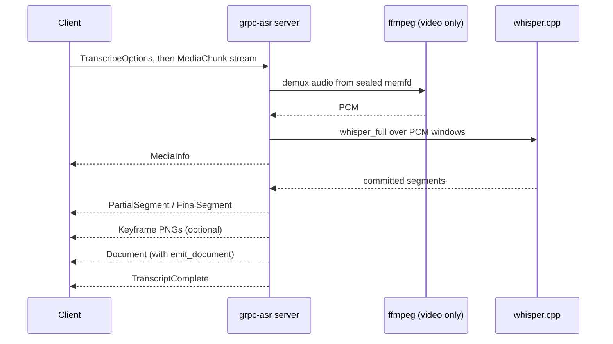

# grpc-asr

gRPC ASR collector (whisper.cpp) for audio and video, projecting transcripts
into the gRParse Document data plane.

A standalone C++ gRPC server embedding whisper.cpp. Media streams in over a
bidirectional `Transcribe` RPC; timed transcript segments stream back as the
decoder commits them, so for audio containers transcription starts while the
upload is still in flight. Video containers are demuxed through ffmpeg over a
memfd (diskless), with optional keyframe stills emitted alongside the
transcript.



## Unified media streaming

This repository is the consolidation target for the former `whisper-grpc`
prototype. The implementation is being qualified before the duplicate projects
are retired. One `grpc-asr-server` registers the existing `AsrService` and the
additive `MediaService` and `SpeechWorkerService` contracts on port 50055.
Existing ASR protobuf messages remain unchanged.

The media API supports incremental direct and allowlisted HTTP input, original
source bytes with checksums, native encoded packets and audio, stream UUIDs,
explicit open/finish accounting, filtered subscriptions and bounded hydration.
An empty subscription UUID list follows all streams on this server, including
future streams. There is no durable replay store. Native FFmpeg calls process
streamable containers without request files or subprocesses. The existing
collector API retains its Document projection, keyframes and seekable-video
compatibility path.

Whisper processing borrows the existing CPU/CUDA/OpenVINO model pool. The two
APIs share loaded weights and concurrency limits. The media-to-worker call uses
an in-process gRPC channel by default; `GRPC_ASR_WORKER_TARGET=host:port`
selects a separately deployed worker using the same typed contract. `GRPC_ASR_STREAM_MODEL`
selects a loaded model for the window worker (defaults to the first loaded model).
`GRPC_ASR_STREAM_BACKEND=parakeet` instead selects the native CPU Parakeet
adapter, with weights at `GRPC_ASR_PARAKEET_MODEL_PATH`; the existing collector
API continues to serve its configured Whisper models. Parakeet supports
transcription, not translation or language hints.

Speech requests select fixed windows or speech-aware boundaries. Mount Silero
weights and set `GRPC_ASR_VAD_MODEL_PATH` for speech-aware chunking. Maximum
window limits still apply when there is no pause; the caller selects failure
or a forced cut with overlap. Raw hypotheses remain available alongside
reconciled revisions, including unresolved joins.

HTTP ingestion is disabled unless `GRPC_ASR_HTTP_ORIGINS` contains exact comma-
separated `scheme://host:port` origins. Private addresses additionally require
`GRPC_ASR_HTTP_ALLOW_PRIVATE=1`. Redirects and nested media URLs are refused.
`GRPC_ASR_MACHINE_ID` optionally supplies a stable UUID for producer metadata.

For a single CPU deployment, put weights in `models/` and run
`docker compose up --build`. All three interfaces use port 50055, bound to
loopback by default. For smart chunking set
`GRPC_ASR_VAD_MODEL_PATH=/models/ggml-silero-v5.1.2.bin` before starting Compose.
Models are mounted read-only and never fetched by requests. Keep
`GRPC_ASR_MODELS` explicit when the directory also contains VAD or Parakeet
weights; automatic Whisper discovery expects only Whisper weights.

For local qualification, provision the weights and run
`bash scripts/qualify-unified.sh build models /path/to/silero.bin whisper`.
The same command with `parakeet` additionally requires
`GRPC_ASR_PARAKEET_MODEL_PATH`. It tests the actual unified server, including
HTTP, fixed/smart video windows, subscription delivery and hydration. Native
ARM and GPU results must be reported separately from CPU results.

## Wire API

`ai.pipestream.asr.v1.AsrService` (see
[`proto/ai/pipestream/asr/v1/asr_service.proto`](proto/ai/pipestream/asr/v1/asr_service.proto)).

`Transcribe(stream TranscribeRequest) returns (stream TranscribeResponse)`:
the first request message carries `TranscribeOptions` (`model`, `language`,
`task`, `word_timestamps`, `emit_keyframes`, `keyframe_interval_seconds`,
`emit_document`, `diarize`, `filename`), the rest carry the encoded media as
`MediaChunk` messages. Response events arrive in order: `MediaInfo`, then
`PartialSegment` and `FinalSegment` events (finals replace partials by
index), optional `Keyframe` PNGs, and a `TranscriptComplete` trailer with
counts.

`diarize` asks the decoder for speaker turns; segments then carry a
stream-local `speaker_id` ("S1", "S2", ...). A model without speaker-turn
training never predicts a turn, so everything stays on the first speaker.

With `emit_document`, one `ai.pipestream.document.v1.Document` event is
emitted immediately before the trailer: the collector-side fold of the
transcript.

- Final segments become text items located by **time provenance**:
  `prov[0].time` is the segment's span in milliseconds, and with
  `word_timestamps` one further entry per word carries that word's span
  plus its charspan (Unicode code points) inside the item text. Speakers,
  when diarizing, ride the spans and are registered once in
  `Document.media.speakers`.
- Every item keeps `TrackSource` (seconds) and
  `CollectorSource{collector: "asr", model, version, confidence}` for
  consumers that already read them. The confidence is a rescaled decoder
  score, not a calibrated probability, so the raw mean token logprob rides
  the same `CollectorSource` as a typed `raw_score` with `raw_score_kind`
  `"avg_logprob"`. A segment that scored no token claims neither field, and
  nothing is written in their place; a score of exactly 0 is a real value.
- The detected language lands in `body.meta.language` (enum plus raw code)
  and in `Document.source_meta.language`; the decoded duration and codec in
  `Document.media`; the filename, sniffed mimetype, and FNV-1a content hash
  in `Document.name` and `Document.origin`.
- Keyframes become picture items whose `ImageRef.uri` is
  `keyframe:<timestamp_ms>`, a pointer back at the typed event rather than
  embedded PNG bytes, so the Document stays one bounded message; the frame's
  true instant is its own zero-length time span.

The typed event stream remains the lossless wire: per-word probabilities,
segment indexes, and the trailer's counts stay there. The document schema is
vendored verbatim from gRParse
(`proto/ai/pipestream/document/v1/document.proto`); do not edit it here.

`GetServiceInfo` reports the build, backend, loaded models, and caps, plus
the `UiInfo` block the shared demo shell reads to build its tab bar.
Standard `grpc.health.v1.Health` and server reflection are registered.

Containers: wav, mp3 and flac decode in process; ogg (Vorbis, Opus),
mp4/mov and mkv/webm are demuxed by ffmpeg once the upload is complete
(the media needs an audio track). Raw ADTS AAC is not sniffed and is
refused as an unknown container. Errors: cap overruns are
`RESOURCE_EXHAUSTED`, undecodable media is `INVALID_ARGUMENT`, unknown
containers are `UNIMPLEMENTED`, decoder faults are `INTERNAL`.

A stream stops working the moment its client cancels or its deadline
passes, whether it is decoding speech or a silent stretch that commits no
segment, waiting for a free model state, probing a video, or extracting
keyframes: the decoder and every ffmpeg child watch the call. A stream
that waits for a model state longer than `GRPC_ASR_QUEUE_TIMEOUT_SECONDS`
fails `RESOURCE_EXHAUSTED`.

## Build and test

```bash
cmake -S . -B build -G Ninja -DCMAKE_BUILD_TYPE=Release -DBUILD_TESTING=ON
cmake --build build --target grpc-asr-server grpc-asr-tests
ctest --test-dir build -L asr --output-on-failure
```

gRPC and whisper.cpp are FetchContent-pinned; no system gRPC needed. Two
tests need provisioning and skip (exit 77) without it: `transcriber-test`
and `asr-service-test` need `models/ggml-tiny.en.bin` (`curl -L -o
models/ggml-tiny.en.bin
https://huggingface.co/ggerganov/whisper.cpp/resolve/main/ggml-tiny.en.bin`),
and the video cases need `ffmpeg` and `ffprobe` on PATH. The tests author
their fixtures with `GRPC_ASR_TEST_FIXTURE_FFMPEG` (default `ffmpeg`), which
needs the libx264, libopus and libvorbis encoders; the image builds point it
at a distribution ffmpeg and test the decode-only one they ship.
Set `GRPC_ASR_TEST_REQUIRE_MODELS=1` to turn a missing model or sample into
a test failure instead of a skip; CI does, after fetching the model at a
pinned revision and checking its sha256.

Backend variants: `-DGRPC_ASR_CUDA=ON` (GGML CUDA) and
`-DGRPC_ASR_OPENVINO=ON` (whisper OpenVINO encoder; needs the OpenVINO SDK
at build time and ships as `Dockerfile.openvino`).

## Run

```bash
GRPC_ASR_BACKEND=cpu GRPC_ASR_MODELS_DIR=./models ./build/grpc-asr-server
```

The process loads every configured model at startup and fails loud: a
missing backend or weight file stops the boot, never the first RPC. Weights
are files named `ggml-<model>.bin` in the models dir; `GRPC_ASR_MODELS`
picks a subset, unset discovers all.

| Env | Default | Meaning |
|---|---|---|
| `GRPC_ASR_LISTEN_ADDRESS` | `0.0.0.0:50055` | listen address |
| `GRPC_ASR_BACKEND` | `cuda` | `cuda` \| `openvino` \| `cpu`; never silently substituted |
| `GRPC_ASR_CUDA_DEVICE` | `0` | CUDA device index |
| `GRPC_ASR_OPENVINO_DEVICE` | `GPU` | OpenVINO device for the whisper encoder, e.g. `GPU.1` on a multi-GPU host; the OpenVINO image ships only the GPU plugin, and an unavailable device stops the boot |
| `GRPC_ASR_MODELS_DIR` | `/models` | read-only weight mount |
| `GRPC_ASR_MODELS` | discover | comma list of model names to load |
| `GRPC_ASR_CONCURRENCY` | `2` | whisper states per model (concurrent transcriptions) |
| `GRPC_ASR_QUEUE_TIMEOUT_SECONDS` | `1800` | how long a stream waits for a free whisper state before `RESOURCE_EXHAUSTED`; `0` waits as long as the client does |
| `GRPC_ASR_MAX_MEDIA_BYTES` | `268435456` | upload cap, overrun is `RESOURCE_EXHAUSTED` |
| `GRPC_ASR_MAX_DURATION_SECONDS` | `14400` | media duration cap, overrun is `RESOURCE_EXHAUSTED` |
| `GRPC_ASR_WINDOW_SECONDS` | `480` | PCM window per `whisper_full`; bounds resident PCM |
| `GRPC_ASR_THREADS` | `min(4,hw)` | whisper decode threads |
| `GRPC_ASR_KEYFRAME_INTERVAL_SECONDS` | `10` | default keyframe spacing |
| `GRPC_ASR_DOCUMENT_WORD_PROVENANCE` | `1` | per-word provenance in the folded Document; `0` keeps segment spans only. Costs one provenance entry per word (~150 per transcribed minute, ~72k over eight hours) in a single bounded message |
| `GRPC_ASR_METRICS_INTERVAL_SECONDS` | `60` | stdout metrics line; `0` off |
| `GRPC_ASR_TOOL_INACTIVITY_SECONDS` | `120` | ffmpeg/ffprobe no-output kill timer |
| `GRPC_ASR_FFMPEG` / `GRPC_ASR_FFPROBE` | `ffmpeg`/`ffprobe` | tool paths |

## Docker

Three image variants, one per backend; tests run inside every image build
and gate it:

```bash
docker build -t grpc-asr .                                # CUDA (default)
docker build -f Dockerfile.cpu -t grpc-asr:cpu .          # CPU only
docker build -f Dockerfile.openvino -t grpc-asr:openvino . # Intel OpenVINO
docker run --rm --read-only --tmpfs /tmp --gpus all \
  -v ./models:/models:ro -p 50055:50055 grpc-asr
```

The hot path is diskless: media lives in memory and memfds, so run the
container `--read-only`.

The OpenVINO image carries OpenVINO 2025.4.1 (Intel APT repo, ubuntu24
distribution, on an ubuntu:26.04 base), the Intel GPU plugin, and the NEO
compute runtime (`intel-opencl-icd` 26.05 from Ubuntu's 26.04 archive,
Battlemage-capable); it defaults to `GRPC_ASR_BACKEND=openvino`. The
whisper OpenVINO encoder targets an Intel GPU (`GRPC_ASR_OPENVINO_DEVICE`,
default `GPU`), so the container needs the render device, and the models
mount needs the converted encoder IR
(`ggml-<name>-encoder-openvino.xml` / `.bin`, produced by whisper.cpp's
`convert-whisper-to-openvino` tooling) next to the ggml weights:

```bash
docker run --rm --read-only --tmpfs /tmp --device /dev/dri \
  --group-add $(getent group render | cut -d: -f3) \
  -v ./models:/models:ro -p 50055:50055 grpc-asr:openvino
```

`--group-add render` because the image runs as the unprivileged user, which
has no render-node access otherwise. The OpenVINO compile cache lives under
`/tmp` (tmpfs in the documented run) because the models mount is read-only.
Without `/dev/dri` or without the converted encoder files the server refuses
to boot: OpenVINO encoder init fails loud at startup, never on the first RPC.

Published tags: the CPU image (`:latest-cpu` and versioned `-cpu` tags) is a
multi-arch manifest list, linux/amd64 plus linux/arm64 (each leg builds and
boot-tests natively on a hosted runner of its own architecture). The CUDA
and OpenVINO images are linux/amd64 only.

## Licensing

grpc-asr-server links whisper.cpp and
ggml (MIT), miniaudio (public domain or MIT-0), and gRPC (Apache-2.0) with
the libraries it builds. The container images also ship `ffmpeg` and
`ffprobe`, built from the upstream FFmpeg 9.0.2 release by
[scripts/build-ffmpeg.sh](scripts/build-ffmpeg.sh) without `--enable-gpl` or
`--enable-nonfree` and with only the demuxers and decoders the service uses,
so they are LGPL-2.1-or-later. The streaming API links the FFmpeg shared libraries directly; the existing
collector video and keyframe path also uses the executables. Each image says so in its
`ai.pipestream.ffmpeg.license` label, carries the license text, the exact
configure line and the source tarball under `/opt/ffmpeg/share/doc/ffmpeg`,
and carries the details at `/usr/share/doc/grpc-asr/NOTICE` (this
repository's [NOTICE](NOTICE)).

## Remotes

Forgejo (`git.rokkon.com/ai-pipestream/grpc-asr`) is the source of truth;
`main` lives there. GitHub is a public push-mirror of `main`: do not merge
to GitHub `main`, whose default branch is `development`. Push Forgejo first
and GitHub `main` updates from the Forgejo push-mirror.

## Docs

- [Architecture](docs/architecture.md): where this sits in the collector fleet
- [Design](docs/design.md): wire API, Document mapping, tests
- [Guidelines](docs/guidelines.md): how to build it so it matches the fleet
