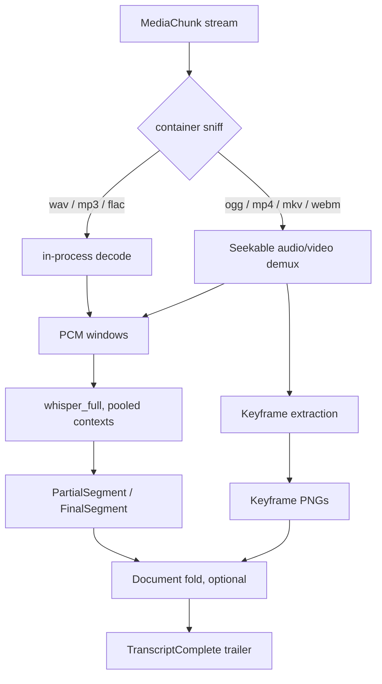

# grpc-asr architecture

**Status:** implemented; canonical home of the consolidated media services
**Updated:** 2026-11-08

Implementers start at [`AGENTS.md`](../AGENTS.md), then this file, `design.md`, and `guidelines.md`.

## Where this sits

Running Whisper inside a general document-conversion process steals the GPU
from layout and OCR work and ties ASR to Python. This service is the
isolated collector for the same feature: it takes audio or video bytes,
streams transcript events back, and hands results to the gRParse
coordinator (`COLLECTOR_ASR`), which merges them into a Document. Optional
keyframe stills from video feed the CV path.

Keep ASR out of gRParse itself: OCR and layout session pools and Whisper
weights do not share a device arena.

The diagram above describes the collector's `AsrService`. Its container
path waits for the complete upload so seekable formats such as trailing-index
MP4 work. `GRPC_ASR_NATIVE_DEMUX` is a CMake option, independent of the speech
backend: ON by default on macOS, OFF by default on Linux. When enabled, it
uses native FFmpeg libraries and seekable in-memory AVIO for audio and PNG
keyframes, without request files or codec subprocesses. Linux can opt in with
`-DGRPC_ASR_NATIVE_DEMUX=ON` and the required FFmpeg development libraries.
The legacy Linux mode uses sealed memfd input with ffmpeg/ffprobe subprocesses
and a separate keyframe child. This option does not make AsrService container
uploads incremental.

The same
`grpc-asr-server` also registers `ai.pipestream.media.v1.MediaService` and
`SpeechWorkerService` on port 50055. These interfaces were consolidated from
the retired whisper-grpc prototype; there is no separate media executable.
MediaService uses native FFmpeg for incremental direct or allowlisted HTTP
input and preserves source bytes, packet metadata and stream lifecycle events.
UUID-filtered subscriptions can hydrate retained events before following live
events. An empty filter follows all streams on the instance; retention is
bounded in memory, not durable storage.

The speech worker shares the collector's Whisper pool by default. The media
worker can instead use native CPU Parakeet TDT transcription; this does not
change the collector's Whisper backend. Fixed windows and Silero speech-aware
windows are implemented for the media API, including explicit maximum-window
behavior and transcript reconciliation. See the README for configuration and
the design document for the distinction between the two ingestion APIs.

## Live results

Segments are emitted as the decoder commits them, and keyframes as they are
extracted, so a UI can show the transcript growing, including on a two-hour
file. A batch convert that returns one document at the end cannot do that.
Partial segments are allowed; finals replace them by index.
`TranscriptComplete` is a trailer.

## What this process owns

Audio decode and transcription use whisper.cpp with explicit CPU, CUDA, SYCL,
Metal or OpenVINO selection, never `openai-whisper`. Video is demuxed to its audio
track, with optional keyframe stills emitted as `PictureItem`s or raw PNGs
so gRParse can run layout on slides. Timed segments (`start`, `end`,
`text`, optional word timestamps) are projected as `TextItem`s with time
provenance, plus a WebVTT-shaped sidecar the sink can export as
`OutputFormat.VTT`. Language detection runs in the decoder. The served
models are the Whisper family (tiny through large-v3, plus distil
variants); weights are files on disk, not a pip extra.

## What this process does not own

| Concern | Owner |
|---|---|
| Diarization, speaker names | later; out of scope for v1 |
| Translation as a product feature | whisper.cpp `task=translate` may be an option, not the default |
| Chunking / embeddings | downstream of Document |
| Export to VTT files | protomolt sink, from the timed items |
| Page OCR | gRParse CV |

## Language

C++. whisper.cpp is the system of record; wrapping it in Python would
recreate the conversion-process cost this service exists to remove. ffmpeg
(or a pure demuxer) is a deployment dependency for video, not a second ASR
stack.

One process, pooled model instances sized by VRAM, bounded concurrent
transcriptions. Fail loud if the requested model file or backend is
missing.

## Hardware

`GRPC_ASR_BACKEND=cpu|cuda|sycl|metal|openvino` selects the implementation at
startup. CPU is explicit; unavailable requested backends/devices fail startup.
Build options and runtime selection are separate:

| Backend | Build option | Runtime device selection and scope |
|---|---|---|
| CPU | No accelerator option needed | CPU Whisper graph |
| CUDA | `GRPC_ASR_CUDA=ON` | `GRPC_ASR_CUDA_DEVICE`, default 0; GGML GPU encoder and decoder path |
| SYCL | `GRPC_ASR_SYCL=ON` | `GRPC_ASR_SYCL_DEVICE`, default 0; GGML GPU encoder and decoder path |
| Metal | `GRPC_ASR_METAL=ON` | `GRPC_ASR_METAL_DEVICE`, default 0; GGML GPU encoder and decoder path on native Apple Silicon macOS |
| OpenVINO | `GRPC_ASR_OPENVINO=ON` | `GRPC_ASR_OPENVINO_DEVICE`; converted encoder model required; encoder-only offload with the GGML decoder on CPU |

CUDA/SYCL/Metal device numbers are zero-based GPU ordinals within the selected
backend registry. The pool maps these to Whisper's device index and checks
the initialized state uses that exact device. SYCL is the full native GGML
speech path, separate from the older OpenVINO encoder-only integration.
Actual per-stage execution still requires placement evidence; configuration
and backend names do not prove complete offload.

Metal runs as a native macOS service, not inside a Linux Docker VM. Keep the
ASR process separate from grparse-server so model allocation is isolated from
OCR/layout sessions. Current Mac receipts are intermediate: final ASR
qualification remains open pending the reviewed duration-cap and timestamp
fixes and a fresh device run. See [Metal status](metal-status.md) for the
source-pinned results and remaining work.
